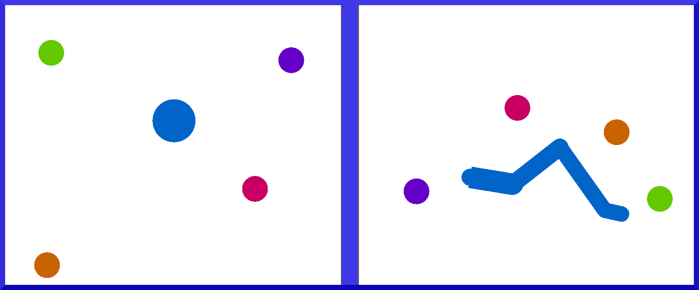

# Toolbox for hybrid models in active inference

  

This repository contains a toolbox  that can help researchers develop computational models and simulations in continuous-time active inference with planning in discrete state space. There are two setups:
- one for robotics, in which a kinematic model (which can be defined from the config file) has to reach one of four moving targets with its end-effector. The active inference agent comprises a hierarchical model with intrinsic and extrinsic levels, representing joint angles and Cartesian positions, respectively;
- one for navigation, in which an agent has to move in an environment and reach one of four moving targets.

In both cases, discrete planning is done by evaluating the likelihood of potential trajectories generated by a dynamic hybrid model (defined by the `DynUnit` class in *unit.py*). Alternatively, one could define static priors over the continuous model and use the `StaticUnit` class.

Every computation of the hybrid units is performed by automatic differentiation through `pytorch`, while the discrete active inference model can be designed using the JAX version of `pymdp` available [here](https://github.com/infer-actively/pymdp/tree/1da9d2452fa59d4475d26addf856e88d5eccf779).

## HowTo

### Start the simulation

The simulation can be launched through *main.py*, either with the option `-m` for manual control, `-i` for the active inference agent. If no option is specified, the last one will be launched.

### Advanced configuration

More advanced parameters can be manually set from *config.py*. Custom log names are set with the variable `log_name`. The number of trials and steps can be set with the variables `n_trials` and `n_steps`, respectively.

The parameter `n_tau` specifies the sampling time window used for evidence accumulation, while `n_policy` controls the length of the policies.

The parameter `n_objects` specifies the number of objects, which are defined in the class `Objects` in *environment/objects.py*.

### Agent

The script *simulation/inference.py* contains a subclass of `Window` in *environment/window.py*, which is in turn a subclass `pyglet.window.Window`. The only overriden function is `update`, which defines the instructions to run in a single cycle. Specifically, the subclass `Inference` initializes the agent and the objects; during each update, it retrieves proprioceptive and visual observations through functions defined in *environment/window.py*, calls the function `inference_step` of the agent, and finally moves the arm and the objects.

The script *brain.py* defines the structure of the hybrid generative model, along with the dynamics functions. The script *unit.py* contains the `Unit` two classes specifiying dynamic and static hybrid units, and the `Obs` class defining an observation modality. Sensory evidence is accumulated in every unit until the next discrete step. Finally, the discrete model is described in *discrete.py*, which performs Bayesian model comparison depending on the hybrid units, and generate the new discrete hidden causes.

Useful trajectories computed during the simulations are stored through the class `Log` in *environment/log.py*.

Note that all the variables are normalized between -1 and 1 to ensure that every contribution to the belief updates has the same magnitude.

## Required libraries

inferactively_pymdp==1.0.0

jax==0.6.0

numpy==2.3.5

pyglet==2.1.11

seaborn==0.13.2

torch==2.9.1